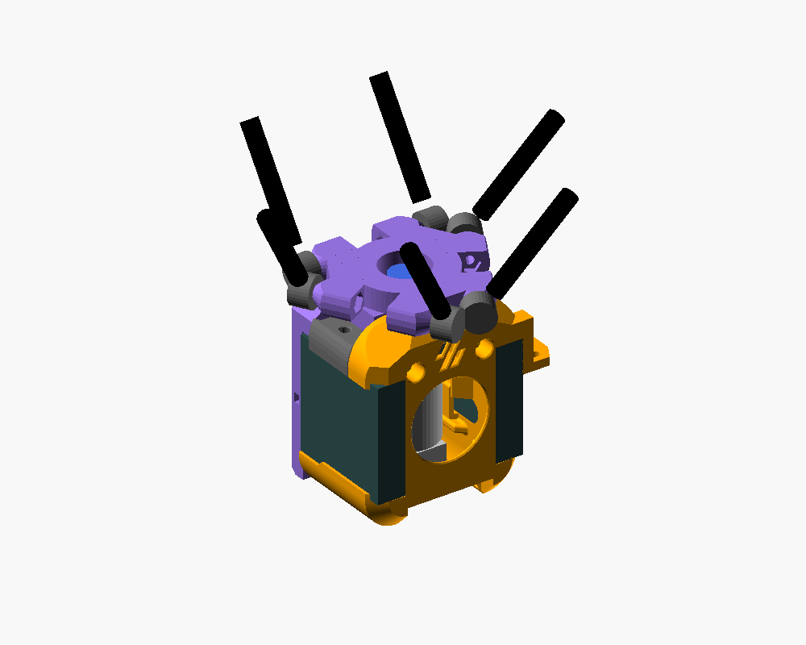
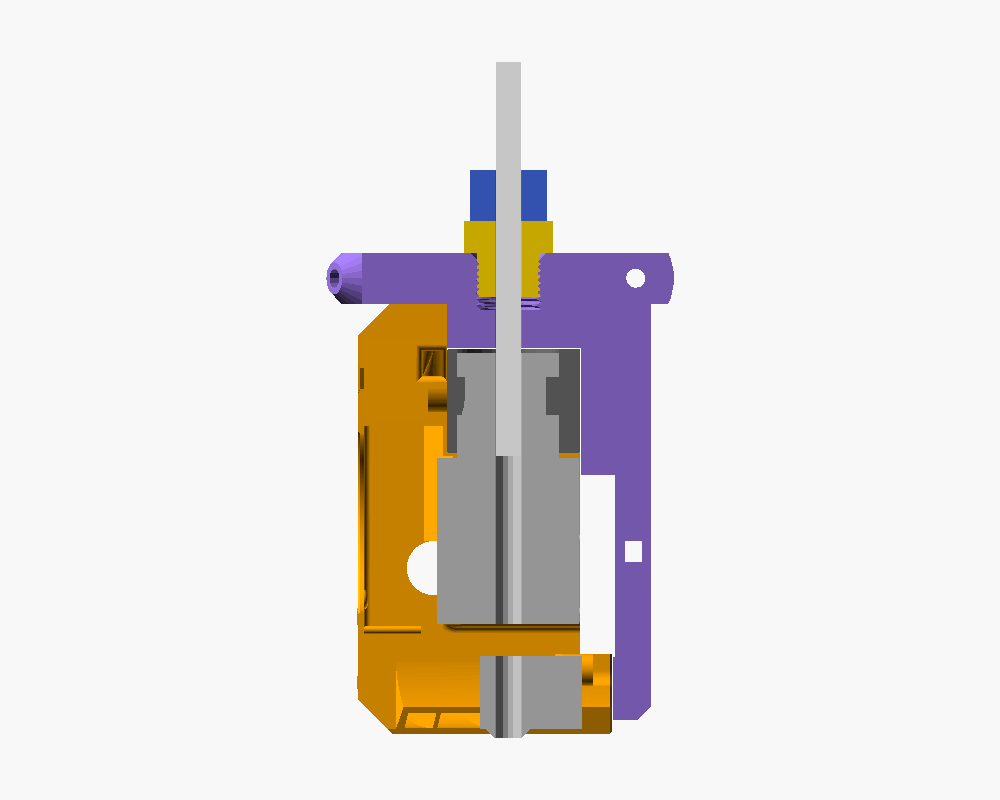

# Effector Kossel Mini para o Dragon Burner (BLTouch, bowden)

Effector para a Kossel Mini ([jcrocholl/kossel](https://github.com/jcrocholl/kossel)) que carrega o toolhead
[Dragon Burner v8 do V0.2](https://github.com/chirpy2605/voron/tree/main/V0/Dragon_Burner) com a carenagem do
remix [Dragon Burner BLTouch/3DTouch](https://www.printables.com/model/822570) (versões `right` e `left`), em
configuração bowden.



## Ideia

- **Juntas das hastes intocadas.** Os ressaltos das juntas são o código do `effector.scad` original, sem alteração:
  separação de 40, offset de 20 (`DELTA_EFFECTOR_OFFSET` continua 20), altura de 8, cones, furos M3 e
  alojamentos de porca. A comparação malha a malha com o original dá 0,000 mm³ de diferença nas 6 faces de junta.
- **O effector é o suporte do extrusor.** Ele assenta direto no topo do Dragon Burner, sem folga: a base fica
  0,1 mm acima do topo da carenagem. Por baixo, um bloco ocupa o lugar do suporte de extrusor/bowden (Sherpa Mini
  Mount, Bowden Mount…), apoiado no suporte do hotend. O bloco prende no topo da carenagem com 2 × M3x25, nos
  mesmos insertos que recebem qualquer suporte de extrusor do Dragon Burner.
- **Furo passante de Ø17 no eixo do bico** para o conector do PTFE, que continua rosqueado no topo do V6 bowden.
  O effector encaixa por cima com o conector já no lugar, e o PTFE desce pelo furo direto até o conector. Ø17 passa
  um sextavado de 14 mm (16,2 mm nas pontas: PC4-M10, PC4-01); para outro conector, mude `connector_clear_d`.
- **Variantes para hotend sem conector no corpo** (`ptfe_fitting` no fonte): o PTFE atravessa o effector por um
  furo de Ø4,3 e desce até o dissipador, e o engate rosqueia no topo do effector, numa rosca impressa M10x1
  (PC4-M10, 9 mm de profundidade) ou M6x1 (PC4-M6, 7 mm), com chanfro de 0,8 mm na entrada. Fora do eixo, a peça
  é a mesma da versão com furo de Ø17.

  
- **Atrás**, uma placa vertical copia a face do carrinho X do Voron V0.2, para o qual o Dragon Burner foi desenhado:
  - 2 × M3x35 pela frente da carenagem, em insertos na placa (os mesmos parafusos do V0);
  - 2 × M3x10 BHCS por trás, nas pernas da placa, nos insertos das abas traseiras dos dutos. Substituem a
    travessa traseira (Brace). As pernas passam atrás das ventoinhas 4010, a 0,5 mm delas; só o centro da placa
    (|x| ≤ 16) encosta na traseira da carenagem.
- A frente do toolhead aponta para a frente da impressora (entre as torres A e B). A placa fica embaixo do par de
  juntas da torre C. O BLTouch fica à direita na versão `right` e à esquerda na `left`.
- O bico (V6) fica cerca de **73,4 mm abaixo do plano das juntas**.

### Por que não os furos do Sherpa Mini

Os padrões de parafuso dos extrusores ficam no eixo X do toolhead, a 14–23 mm do centro. Nessa região passam os
parafusos e as porcas das juntas das torres A e B (as linhas desses parafusos cruzam o eixo X em ±23 mm). A parede
que sobraria entre um furo vertical e o parafuso ou a porca da junta:

| Padrão | Parede (mm) |
|---|---|
| Sherpa Mini / LGX Lite / G2SA Sherpa (±21,75) | −2,1 (cruza o parafuso da junta) |
| Orbiter v2 / G2SA Orbiter / WristWatch | −0,1 |
| Sherpa Micro | −0,2 (porca) |
| DFA | −2,1 |
| Orbiter v1.5 | +0,2 |

Girar o toolhead 180° não resolve. Para mudar a direção dessa linha de furos seria preciso girar o toolhead
30°, e aí a placa traseira cairia embaixo das juntas. Por isso a fixação no topo usa os insertos da carenagem.
O cálculo está em `tools/pattern_fit.py`.

## Arquivos

| Caminho | O que é |
|---|---|
| `stl/effector_dragon_burner.stl` | Peça para imprimir (hotend com o conector do PTFE no topo) |
| `stl/effector_dragon_burner_pc4_m10.stl`, `..._pc4_m6.stl` | Variantes para hotend sem conector: rosca para PC4-M10 ou PC4-M6 |
| `src/effector_dragon_burner.scad` | Fonte paramétrico (OpenSCAD) |
| `src/toolhead.scad`, `src/check.scad` | Toolhead posicionado e visualização/checagens |
| `tools/verify.py`, `tools/pattern_fit.py` | Checagens de interferência, juntas, insertos, BLTouch e padrões de extrusor |
| `images/` | Vistas da montagem, da peça e da orientação de impressão |
| `parts/`, `vendor/kossel-orig-render/` | Referências das checagens: carenagem do remix, peças exportadas do STEP do Dragon Burner (`parts/step/`) e o effector original renderizado |
| `tools/step_mounts.py`, `tools/export_step_parts.py` | Posição e exportação das peças do STEP para `parts/step/` |

## Impressão

- ABS/ASA, como o próprio Dragon Burner. As pernas ficam a poucos mm do bloco aquecedor, então PETG só com
  câmara fria.
- **De cabeça para baixo**: a face de cima do effector na mesa e a placa para cima (`images/impressao.png`). Não
  precisa de suporte; a maior ponte tem 12 mm, onde o bloco cruza o vão dos ressaltos A/B.
- 4 perímetros, 40% de preenchimento. Volume sólido: 31,9 cm³ (≈33 g de ABS a 100%); variantes PC4-M10 34,5 cm³
  e PC4-M6 35,0 cm³.
- Nas variantes PC4, a rosca começa na primeira camada; o chanfro da entrada absorve o esmagamento dela. A rosca
  tem 0,3 mm de folga no diâmetro (`thread_clearance`): se o engate entrar duro, rosqueie devagar (o latão abre a
  rosca no plástico) ou passe um macho M10x1 / M6x1; se ficar folgado, reduza a folga e reimprima.

## Peças do Dragon Burner

- Carenagem do remix: `Dragon_Burner_BLTouch_right.stl` ou `..._left.stl`.
- O suporte do hotend que você vai usar (V6, Dragon, Rapido, Revo…). Qualquer padrão de extrusor serve, porque os
  insertos de cima do suporte do hotend não são usados. Todos foram checados contra o bloco e a placa.
- **Não** imprima suporte de extrusor nem `Bowden_Mount`: o effector faz esse papel.
- **Não** use a travessa traseira (Brace_Straight/Brace_Loop): as pernas da placa fazem esse papel.
- O J-head original da Kossel não é suportado pelo Dragon Burner.

## Ferragens

| Qtde | Item | Onde |
|---|---|---|
| 2 | Inserto M3x5x4 (furo Ø4,7, igual ao do Dragon Burner) | Face da frente da placa |
| 2 | M3x35 | Carenagem → placa |
| 2 | M3x25 | Por trás da placa → insertos do topo da carenagem |
| 2 | M3x10 BHCS | Pernas da placa → insertos dos dutos |
| 1 | Engate PC4-M10 ou PC4-M6 (só nas variantes PC4) | Topo do effector |
| — | Insertos do próprio Dragon Burner: 2 no topo da carenagem, 2 nas abas dos dutos | Conforme o BOM dele |
| 6 | Parafusos e porcas M3 das juntas | Como no effector original |

Os furos dos M3x35 atravessam a placa. Se preferir porca a inserto, use M3x40 com porca atrás.

## Montagem

1. Ponha os 2 insertos na face da frente da placa.
2. Monte o Dragon Burner sem o suporte de extrusor: hotend no suporte com o conector do PTFE já rosqueado no
   topo, ventoinhas e os insertos do topo da carenagem e das abas dos dutos.
3. Encaixe o effector por cima: o conector passa pelo furo central, o bloco entra no lugar do suporte de
   extrusor, sobre o suporte do hotend, e a placa encosta na traseira.
4. Aperte os 2 × M3x35 pela frente da carenagem.
5. Por trás: 2 × M3x25 nos furos rebaixados de cima e 2 × M3x10 nas pernas.
6. Desça o PTFE pelo furo central até o conector do hotend.
7. Leve os fios pela traseira da placa e prenda com abraçadeiras nas janelas das pernas.

Nas variantes PC4, o hotend vai sem conector (passos 2, 3 e 6). Depois do passo 5, rosqueie o engate no topo do
effector, passe o PTFE por ele até encostar no fundo do dissipador (no heatbreak) e, empurrando o tubo para baixo,
puxe o colar do engate para cima para travar.

## Firmware

- Raio do delta e `DELTA_EFFECTOR_OFFSET`: não mudam, porque as juntas são as mesmas.
- Altura: refaça a calibração de altura do delta (`G33` no Marlin, `DELTA_CALIBRATE` no Klipper) e o Z offset.
- Offset do BLTouch (pino em relação ao bico). Medi nas STLs com o toolhead montado:

  | Versão | X | Y | Publicado pelo autor |
  |---|---|---|---|
  | right | +33,25 | −10,88 | +32,95 / −10,718 |
  | left | −33,24 | −10,88 | — |

  Use um dos dois e calibre o Z do probe (`M851` / `PROBE_CALIBRATE`). Isso supõe +Y apontando para a torre C
  (traseira), como na configuração padrão da Kossel.
- Com o probe 33 mm fora do centro, reduza o raio de sondagem (`PROBING_MARGIN`/raio do `G33` no Marlin, `radius`
  do `[delta_calibrate]` no Klipper) para o probe não sair da mesa.
- O toolhead fica bem mais pesado que o J-head. Comece com acelerações menores.
- O Dragon Burner recomenda ventoinhas de 24 V. Se a eletrônica da Kossel for 12 V, compre 3010 e 4010 de 12 V.

## O que foi verificado

Tudo com as peças reais (STL do remix e STEP do Dragon Burner v8), no referencial do bico:

- **Effector × carenagem (right e left) e 7 suportes de hotend (V6, Dragon, Revo Micro e as variantes Sherpa
  Micro, Orbiter e DFA):** nenhuma interferência. As folgas mínimas ficam nas faces de encosto:
  - 0,05–0,14 mm entre o bloco e o topo do suporte do hotend;
  - 0,07 mm entre o bloco e a parede da carenagem com os insertos;
  - 0,14 mm entre a placa e a traseira do suporte do hotend;
  - 0,10 mm entre as pernas e as abas dos dutos.
- **Ventoinhas 4010:** não estão nem na STL do remix nem no STEP. Modelei como caixas de 10 × 40 × 40 pelo alojamento
  delas: entre a parede lateral da carenagem (|x| 16,5) e a borda do duto, do topo do duto (z 16) até a aba de
  cima da carenagem (z 56), na profundidade inteira do toolhead (y −23,69 a 16,31, como as abas dos dutos). A
  placa fica a 0,5 mm delas. A versão anterior invadia 4,8 mm na traseira de cada uma.
- **Insertos do topo da carenagem:** existem no remix, em x ±12,5 e z 67,35, alinhados com os furos dos M3x25.
- **Terminações das hastes (modeladas como Traxxas 5347, esfera de 7,5 mm de raio de giro):** ficam a ≥11,1 mm
  do toolhead e não tocam o bloco nem a placa. Na região mais apertada, a da torre C, a placa fica a 0,5 mm
  dessa esfera (com raio de 8,1 mm já tocaria).
- **Paredes, fatiando de cabeça para baixo com camadas de 0,2 mm:** nenhuma abaixo de 0,9 mm. Ao lado dos
  rebaixos dos M3x25 a placa alarga até onde as terminações da torre C permitem, e a parede fica com 2,4 mm ou
  mais. Os pontos mais finos da peça são a frente do bloco, junto ao furo do conector (1,1 mm), a parede do inserto
  do M3x35 junto à ventoinha (1,15 mm) e as janelas das abraçadeiras (1,5 mm).
- **Juntas:** idênticas ao `effector.scad` original. Do original só mudou o furo central: era Ø16 em cima e
  rosca M5 embaixo, agora é passante de Ø17.
- **Furo do conector:** o topo do V6 fica 0,6 mm abaixo do topo do suporte do hotend, então o sextavado do
  conector fica quase todo dentro do furo do effector, com 0,4 mm de folga de cada lado para um sextavado de
  14 mm. Na frente do bloco a parede fica com 1,1 mm, encostada na parede da carenagem, e há 2,3 mm entre o furo
  e os M3x25.
- **Variantes PC4:** comparadas malha a malha com a versão base, só ganham material dentro do antigo furo de Ø17,
  sem perder nada, e esse material não toca nenhuma peça do toolhead; as folgas acima valem para elas. Fatiando a
  rosca: M10x1 de Ø9,22 a 10,30 (M6x1: 5,22 a 6,30), passo de 1 mm, à direita; abaixo dela, Ø4,3 até o fundo do
  bloco. Paredes: nenhuma abaixo de 0,9 mm.

Ainda não verificado:

- A peça não foi impressa nem montada.
- O STEP do Dragon Burner mostra a pilha suporte do hotend + suporte do extrusor 13,25 mm acima da posição
  montada, e a carenagem 1,43 mm à frente. Assentei tudo pelos parafusos e pelo contato com a carenagem: as
  traseiras ficaram coplanares a 0,1 mm, e o offset do BLTouch bateu com o do autor a 0,3 mm. Mesmo assim, confira o
  encaixe no primeiro teste.
- Se você usar juntas diferentes das Traxxas (magnéticas, por exemplo), confira a folga das terminações.
- A rosca impressa das variantes PC4 não foi testada (ver Impressão).
- Atrás das 4010 sobra só 0,5 mm até as pernas. Se o fio da sua ventoinha sai pela face de trás, leve-o para
  cima ou para fora antes de encaixar o effector.

## Regerar

Tudo roda em Docker (`openscad/openscad:dev` e a imagem de `tools/Dockerfile`):

```sh
docker run --rm --user $(id -u):$(id -g) -v $PWD:/p -w /p/src openscad/openscad:dev \
  openscad --backend=manifold -o ../stl/effector_dragon_burner.stl effector_dragon_burner.scad
docker run --rm --user $(id -u):$(id -g) -v $PWD:/p -w /p/src openscad/openscad:dev \
  openscad --backend=manifold --export-format binstl -D 'ptfe_fitting="PC4-M10"' \
  -o ../stl/effector_dragon_burner_pc4_m10.stl effector_dragon_burner.scad   # idem PC4-M6 -> _pc4_m6.stl
docker build -t kossel-cad-tools tools/
docker run --rm --cpus 2 -v $PWD:/p:ro kossel-cad-tools python -I /p/tools/verify.py /p toolhead   # seat, rod, joints, cowl_inserts, bltouch, walls
docker run --rm --cpus 2 -e STL=effector_dragon_burner_pc4_m10 -v $PWD:/p:ro kossel-cad-tools \
  python -I /p/tools/verify.py /p thread   # walls também; toolhead fica pesado com a malha da rosca
```

A imagem do corte sai de `check.scad` com `-D 'view="section"' -D 'ptfe_fitting="PC4-M10"' --render`.

## Créditos e licença

GPLv3 (`LICENSE`), herdada do effector da Kossel. O projeto usa e redistribui partes de:

- [jcrocholl/kossel](https://github.com/jcrocholl/kossel) (GPLv3): o código dos ressaltos das juntas e
  `src/configuration.scad`; `vendor/kossel-orig-render/` é o `effector.scad` original renderizado, para comparar as
  juntas.
- [Dragon Burner, de chirpy2605](https://github.com/chirpy2605/voron/tree/main/V0/Dragon_Burner) (GPLv3):
  `parts/step/` foi exportado do `Dragon_Burner_v0.2_v8.step`. Para reexportar, clone o repositório em
  `vendor/chirpy2605-voron` (usei o commit `cc2e749`).
- [Dragon Burner BLTouch/3DTouch, de mtczekajlo](https://www.printables.com/model/822570) (GPLv3):
  `parts/dragon_burner_bltouch_right.stl` e `..._left.stl`.
